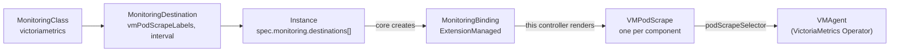

# monitoring-victoriametrics

> [!WARNING]
> **Pre-alpha.** OpenEverest v2 and its monitoring extensions are under active development.
> CRD schemas, chart values and defaults change frequently, including in breaking ways, and
> there is no supported upgrade path between versions yet. Not for production use.

[](https://github.com/openeverest/monitoring-victoriametrics/actions/workflows/ci.yaml)
[](https://github.com/openeverest/monitoring-victoriametrics/releases)
[](LICENSE)

Send the metrics of [OpenEverest](https://github.com/openeverest/openeverest) database
instances to a VMAgent run by the
[VictoriaMetrics Operator](https://github.com/VictoriaMetrics/operator).

## What this is

A monitoring extension for OpenEverest. It installs the `victoriametrics` `MonitoringClass`
and the controller that fulfils it. The class is **ExtensionManaged**: the database provider
only exposes metrics endpoints, and this controller turns them into one native `VMPodScrape`
per database component, which the VMAgent you already run picks up through its
`podScrapeSelector`.

> [!IMPORTANT]
> **This extension is not standalone.** It requires an OpenEverest installation (core CRDs and
> controller) and a VictoriaMetrics Operator with a `VMAgent` in the cluster. It does not
> install either of them.

## Compatibility

| monitoring-victoriametrics | OpenEverest | VictoriaMetrics Operator |
|---|---|---|
| `0.1.x` | `2.0.0-dev.5` | `v0.75.x` |

## How it fits



1. **Class.** The chart installs the cluster-scoped `victoriametrics` class, and the controller
   claims the MonitoringClass named by `class.name` (`--class-name`): `Accepted=True`. The
   class requires metrics, so OpenEverest computes per provider whether each component serves
   metrics natively or needs an exporter sidecar:
   `kubectl get mclass victoriametrics -o yaml` shows it under `status.providers`.
2. **Destination.** A `MonitoringDestination` in the Instance's namespace references the class
   and says how the generated VMPodScrapes are labelled and how often they are scraped.
3. **Instance entry.** Listing the destination under `spec.monitoring.destinations[]` of an
   Instance sends that Instance's metrics there.
4. **Binding.** OpenEverest creates one `MonitoringBinding` per entry and accepts it. The
   provider then enables the exporters it needs (adding an exporter sidecar restarts the pods
   one at a time) and publishes the serving endpoints in `Instance.status.monitoring.sources`.
5. **VMPodScrape per component.** For every Accepted binding of the class, the controller
   applies one `VMPodScrape` per component, named `<binding>-<component>` (lower-cased), in the
   Instance's namespace and owned by the binding. A component that stops publishing metrics
   loses its VMPodScrape. Removing the Instance entry deletes the binding, and Kubernetes
   garbage-collects its VMPodScrapes.

Besides the VMPodScrapes, the controller writes three conditions and nothing else: the class's
`Accepted`, each binding's `Configured` and each destination's `Ready`.

Every scrape endpoint carries, through `relabelConfigs`, the identity labels
`openeverest_instance`, `openeverest_namespace`, `openeverest_provider` and `k8s_cluster_id`
(the UID of the `kube-system` namespace), plus `openeverest_component` and `openeverest_kind`.
Endpoints that probe several targets through a `target` query parameter also get the target
as their `instance` label, so each probed target is its own series.

Credentials are passed by reference only. An endpoint that needs authentication gets
`basicAuth` pointing at the `username` and `password` keys of the Secret the Instance publishes
for that credential profile, and a TLS CA becomes `tlsConfig.ca.secret`. The controller never
reads those Secrets; the VictoriaMetrics Operator resolves them when it builds the VMAgent
configuration.

The VictoriaMetrics Operator can also convert Prometheus Operator objects (`PodMonitor`,
`ServiceMonitor`) into VM objects. That converter is unrelated to this extension: the scrapes
here are native `VMPodScrape`s and need no conversion. If an Instance is also sent to a
[monitoring-prometheus](https://github.com/openeverest/monitoring-prometheus) destination while
the converter is on, a VMAgent that selects the converted objects scrapes that Instance twice.

## Prerequisites

- OpenEverest with the monitoring API (see [Compatibility](#compatibility)).
- The VictoriaMetrics Operator, or at least its CRDs (`VMPodScrape`,
  `operator.victoriametrics.com/v1beta1`). Without them the controller still starts, and every
  binding reports `Configured=False` with reason `ApplyFailed` and retries every 30 seconds.
- A `VMAgent` that selects the generated VMPodScrapes in the Instances' namespaces.
- A database provider that publishes metrics endpoints (its `Provider` declares
  `spec.monitoring.componentTypes`).

## Installation

The chart is published as an OCI artifact to GitHub Container Registry:

```bash
helm install monitoring-victoriametrics \
  oci://ghcr.io/openeverest/charts/monitoring-victoriametrics \
  -n openeverest-system
```

Check that the class is claimed:

```bash
kubectl get monitoringclass victoriametrics
```

Upgrade and uninstall:

```bash
helm upgrade monitoring-victoriametrics \
  oci://ghcr.io/openeverest/charts/monitoring-victoriametrics -n openeverest-system
helm uninstall monitoring-victoriametrics -n openeverest-system
```

Uninstalling removes the class and the controller. Existing `VMPodScrape`s stay until their
Instance entries are removed.

| Chart value | Default | Purpose |
|---|---|---|
| `class.create` | `true` | Install the `MonitoringClass` |
| `class.name` | `victoriametrics` | Name of the class; the controller claims and serves only this class |
| `class.displayName` | `VictoriaMetrics` | Name shown in the UI |
| `image.repository` | `ghcr.io/openeverest/monitoring-victoriametrics` | Controller image |
| `image.tag` | chart `appVersion` | Controller image tag |
| `leaderElection.enabled` | `true` | Required for `replicaCount` above 1 |
| `logLevel` | `info` | `debug`, `info` or `error` |

All values are in [values.yaml](charts/monitoring-victoriametrics/values.yaml).

## Usage

### 1. Point a VMAgent at the VMPodScrapes

Choose a label for the VMPodScrapes this extension creates and select it through the
`podScrapeSelector` of your `VMAgent`. Without `podScrapeNamespaceSelector` a VMAgent only
selects `VMPodScrape`s in its own namespace; `{}` selects every namespace.

```yaml
apiVersion: operator.victoriametrics.com/v1beta1
kind: VMAgent
metadata:
  name: openeverest
  namespace: monitoring
spec:
  podScrapeNamespaceSelector: {}
  podScrapeSelector:
    matchLabels:
      openeverest.io/vmagent: openeverest
  remoteWrite:
    - url: http://vmsingle-main.monitoring.svc:8428/api/v1/write
```

A VMAgent that sets neither `podScrapeSelector` nor `podScrapeNamespaceSelector` selects every
`VMPodScrape` in the cluster when `selectAllByDefault` is `true`, and none otherwise.

### 2. Create a destination

```yaml
apiVersion: monitoring.openeverest.io/v1alpha1
kind: MonitoringDestination
metadata:
  name: victoriametrics
  namespace: my-databases
spec:
  classRef:
    name: victoriametrics
  parameters:
    vmPodScrapeLabels:
      openeverest.io/vmagent: openeverest
    interval: 30s
```

| Parameter | Type | Purpose |
|---|---|---|
| `vmPodScrapeLabels` | map of strings | Labels put on every generated `VMPodScrape`; match them with the VMAgent's `podScrapeSelector` |
| `interval` | Prometheus duration (`30s`, `1m`) | Scrape interval; when unset, the VMAgent's `scrapeInterval` applies |

Neither parameter is required, but without `vmPodScrapeLabels` a VMAgent that selects by label
picks up none of the VMPodScrapes. Any other parameter is rejected: OpenEverest reports the
destination `Accepted=False` with reason `InvalidParameters`. The destination needs no
`authentication`: it defaults to the class's only mode, `Anonymous`, because the VMAgent scrapes
the pods directly and remote write authentication is part of the VMAgent.

```bash
kubectl -n my-databases get mdest victoriametrics
```

`Ready=True` means the parameters are valid; the message shows the labels the VMPodScrapes
get. It does not check that a VMAgent selects them. A label key reserved for OpenEverest
(`core.openeverest.io/instance` or `monitoring.openeverest.io/*`), an invalid label key or
value, or an `interval` that is not a Prometheus duration gives `Ready=False` with reason
`InvalidParameters`, and the destination's bindings report `RenderFailed`.

### 3. Send an Instance's metrics there

```yaml
apiVersion: core.openeverest.io/v1alpha1
kind: Instance
metadata:
  name: my-instance
  namespace: my-databases
spec:
  # ...
  monitoring:
    destinations:
      - name: vm
        destinationRef:
          name: victoriametrics
```

```bash
kubectl -n my-databases get monitoringbindings -l core.openeverest.io/instance=my-instance
kubectl -n my-databases get vmpodscrapes -l core.openeverest.io/instance=my-instance
```

Every generated VMPodScrape is labelled with `core.openeverest.io/instance` and
`monitoring.openeverest.io/class` in addition to `vmPodScrapeLabels`. `Configured=True` lists
the VMPodScrapes in its message. The metrics carry `openeverest_instance="my-instance"` and
`openeverest_namespace`, so a query such as `up{openeverest_instance="my-instance"}` shows one
series per scraped pod.

## Troubleshooting

`kubectl -n my-databases get mbind <name> -o yaml` shows the binding's `Configured` condition:

| Reason | Meaning |
|---|---|
| `Pending` | OpenEverest has not accepted the binding yet |
| `NotAccepted` | OpenEverest rejected the binding, which owns no VMPodScrapes; the message carries its `Accepted` reason |
| `Retained` | The binding is not accepted but still owns VMPodScrapes, which are kept as they are |
| `EndpointNotServing` | The Instance has not published its monitoring sources yet (it is starting), and the binding's VMPodScrapes are kept as they are; or it publishes no metrics endpoints (its exporters are being enabled), and the binding's VMPodScrapes are deleted |
| `RenderFailed` | The Instance or destination is missing, the destination parameters are invalid, or a published endpoint cannot be rendered (for example its pod selector does not select the Instance's pods by `core.openeverest.io/instance`, or it references a credential profile the Instance does not publish); VMPodScrapes already in place are kept |
| `ApplyFailed` | Writing a VMPodScrape failed, usually because the VictoriaMetrics Operator CRDs are not installed; retried every 30 seconds |
| `Configured` | The VMPodScrapes are in place |

If the binding is `Configured` but the VMAgent scrapes nothing, check its `podScrapeSelector`
and `podScrapeNamespaceSelector` (or `selectAllByDefault`) against the VMPodScrapes' labels and
namespace, and the VictoriaMetrics Operator logs for rejected VMPodScrapes.

Controller logs:

```bash
kubectl -n openeverest-system logs deploy/monitoring-victoriametrics -f
```

## Development

Requires Go (see [go.mod](go.mod)), Docker, Helm, kubectl, and for the integration tests k3d
and [chainsaw](https://kyverno.github.io/chainsaw/).

```bash
make build        # bin/controller
make test-unit
make lint
make helm-lint
make run          # run the controller against the current kubeconfig
```

`make run` needs the class in the cluster:
`helm template x charts/monitoring-victoriametrics -s templates/monitoringclass.yaml | kubectl apply -f -`.

### Integration tests

The chainsaw suite under [test/integration/](test/integration/) runs in a k3d cluster that holds
only CRDs: the OpenEverest CRDs of the core version [go.mod](go.mod) pins, and the
VictoriaMetrics Operator CRDs of `VM_OPERATOR_VERSION`. No OpenEverest controller or provider
runs; the test publishes an Instance's monitoring sources and creates and accepts the
Instance-owned binding itself, then asserts the generated `VMPodScrape`s, the binding and
destination conditions, pruning, and garbage collection. The controller runs in a namespace
that enforces the restricted Pod Security Standard.

```bash
make k3d-cluster-up
make docker-build load-image IMG=monitoring-victoriametrics:dev
make install-crds
make deploy-ci IMG=monitoring-victoriametrics:dev
make test-integration
make k3d-cluster-down
```

CI ([.github/workflows/ci.yaml](.github/workflows/ci.yaml)) runs lint, build, unit tests,
module tidiness, copyright headers, Helm lint and the integration suite on every pull request.

### Releasing

Pushing a `vX.Y.Z` (or `vX.Y.Z-<suffix>`) tag builds the multi-arch image
`ghcr.io/openeverest/monitoring-victoriametrics:X.Y.Z`, then publishes the chart with that
version to `oci://ghcr.io/openeverest/charts` and creates the GitHub release. The release
fails unless the [Compatibility](#compatibility) table has a row for the tag's minor series.
Every push to `main` publishes `ghcr.io/openeverest/monitoring-victoriametrics-dev`.

## Contributing

Issues and pull requests are welcome. Commits must be signed off (`git commit -s`). See the
[OpenEverest Code of Conduct](https://github.com/openeverest/openeverest/blob/main/CODE_OF_CONDUCT.md).

## Security

Report vulnerabilities per the
[OpenEverest security policy](https://github.com/openeverest/openeverest/blob/main/SECURITY.md).
Please do not open public issues for security reports.

## License

Apache License 2.0 — see [LICENSE](LICENSE) for details.
